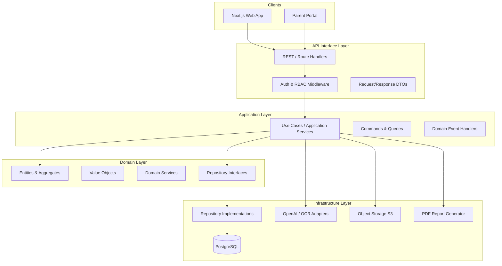
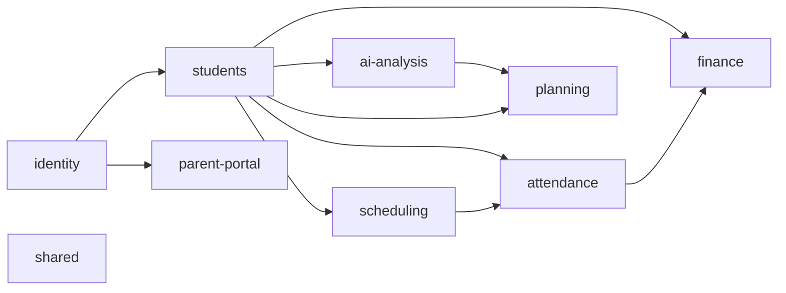
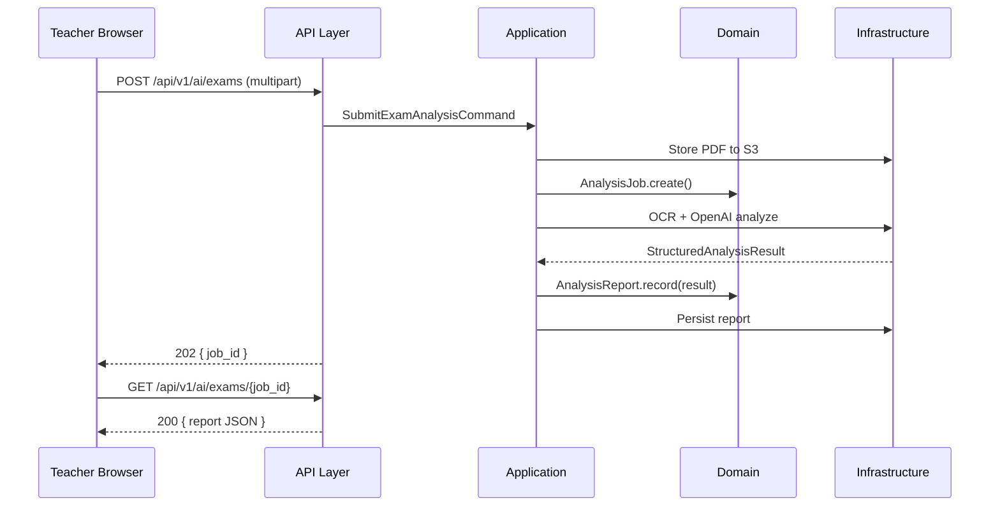

# System Architecture — Faculty Management System (Spinozah AI Education)

## 1. Document Purpose

This document defines the **module design** and **layered architecture** for the Faculty Management System (AI Education Management Platform). The system follows **Domain-Driven Design (DDD)** with four strict layers to achieve clear separation of concerns, testability, and maintainability.

**Product scope:** AI-powered education management for tutoring centers — student/teacher operations, scheduling, attendance, finance, parent portal, and AI-assisted learning analytics.

---

## 2. Architecture Overview

### 2.1 High-Level Diagram



### 2.2 Layer Responsibilities

| Layer | Responsibility | Must NOT |
|-------|----------------|----------|
| **API Interface** | HTTP routing, input validation, auth guards, response mapping | Business rules, SQL, direct domain mutation without use cases |
| **Application** | Orchestrate use cases, transactions, DTO mapping, publish domain events | Framework-specific code, raw SQL |
| **Domain** | Business rules, invariants, aggregates, domain services | DB, HTTP, third-party SDKs |
| **Infrastructure** | Persistence, external APIs, file storage, email | Business policy decisions |

**Dependency rule:** Dependencies point inward only. Domain has zero outward dependencies.

---

## 3. Four-Layer Design (DDD)

### 3.1 API Interface Layer

**Location (target):** `backend/app/api/` (FastAPI routers) and `app/api/` (Next.js Route Handlers for BFF/proxy where needed).

**Responsibilities:**

- Expose RESTful endpoints (`/api/v1/...`)
- Validate request payloads (Pydantic / Zod)
- Enforce authentication (JWT) and RBAC (`admin`, `frontdesk`, `teacher`, `parent`)
- Map HTTP status codes and error envelopes
- Pagination, filtering, and sorting parameters

**Example endpoint groups (shipped):**

| Prefix | Module |
|--------|--------|
| `/api/v1/auth` | Login, refresh, logout |
| `/api/v1/users` | Admin user management |
| `/api/v1/students` | Student CRUD |
| `/api/v1/enrolments` | Lesson packages |
| `/api/v1/teachers` | Teacher CRUD |
| `/api/v1/schedules` | Timetable, conflict checks |
| `/api/v1/attendance` | Check-in, leave requests |
| `/api/v1/invoices` | Billing |
| `/api/v1/analyses` | Persist exam/essay analysis records |
| `/api/v1/parent` | Magic link + parent portal (scoped to children) |
| `/api/v1/admin/...` | KPI read models |

**AI generation:** Next.js BFF under `app/api/ai/` (exams, essays, Cambridge plans, university pathway + PDF). Ops CRUD and analysis persistence use FastAPI.

---

### 3.2 Application Layer

**Location (target):** `backend/app/application/`

**Responsibilities:**

- **Use cases** — one class/function per user intent (e.g. `ApproveLeaveRequest`, `GenerateSemesterInvoice`)
- Coordinate domain objects and repositories
- Manage unit-of-work / database transactions
- Translate between API DTOs and domain models
- Emit integration events (e.g. notify parent after attendance)

**Patterns:**

- **Command handlers** for writes (`CreateStudentCommand` → `CreateStudentHandler`)
- **Query handlers** for reads (`GetTeacherScheduleQuery`)
- No business rules that belong in domain — only orchestration

**Example flow — leave approval:**

```
API POST /attendance/leave/{id}/approve
  → ApproveLeaveHandler
    → LeaveRequest.approve()          [Domain]
    → AttendancePolicy.apply()        [Domain Service]
    → ScheduleRepository.reschedule()   [Infrastructure via interface]
    → EventPublisher.publish(LeaveApproved)
```

---

### 3.3 Domain Layer

**Location (target):** `backend/app/domain/<bounded_context>/`

**Responsibilities:**

- **Aggregates** with consistency boundaries
- **Value objects** (e.g. `LessonCount`, `Money`, `TimeSlot`)
- **Domain services** for cross-aggregate logic (e.g. schedule conflict detection)
- **Repository interfaces** (ports) — no implementation here
- **Domain events** (e.g. `LessonCompleted`, `InvoiceOverdue`)

**Core invariants (examples):**

| Context | Rule |
|---------|------|
| Attendance | First 2 leaves per term are free; additional leaves extend semester |
| Scheduling | No overlapping lessons for same teacher or classroom |
| Finance | `final_amount = subtotal - credit` (non-negative) |
| Students | Remaining lessons = total − completed |

**Forbidden in domain layer:**

- SQLAlchemy imports
- FastAPI / HTTP types
- Environment variables
- Direct calls to OpenAI or S3

---

### 3.4 Infrastructure Layer

**Location (target):** `backend/app/infrastructure/`

**Responsibilities:**

- **Repository implementations** (SQLAlchemy async)
- **Database migrations** (Alembic)
- **AI adapters** — OpenAI client, prompt templates, structured JSON parsing
- **OCR / PDF** — Tesseract, pdf-parse, ReportLab
- **Object storage** — AWS S3 uploads
- **Email / notifications** — SMTP or provider SDK

**Multi-tenancy:** Every repository query MUST filter by `tenant_id`. Include `tenant_a_cannot_see_tenant_b_data` tests for each aggregate repository.

---

## 4. Bounded Contexts (Modules)

Each bounded context maps to a deployable module boundary in code. Cross-context communication uses application services or domain events — not shared mutable entities.



### 4.1 Module Catalog

| Bounded Context | Scope | Key Aggregates |
|-----------------|-------|----------------|
| **identity** | Auth, users, roles, tenants | `User`, `Tenant`, `Role` |
| **students** | Enrolment, profiles, lesson balances | `Student`, `Enrolment` |
| **scheduling** | Timetables, classrooms, conflicts | `Schedule`, `TimeSlot`, `Classroom` |
| **attendance** | Check-in, leave, deductions | `AttendanceRecord`, `LeaveRequest` |
| **finance** | Invoices, payments, credits | `Invoice`, `Payment` |
| **ai-analysis** | Exam/essay/question analysis | `AnalysisJob`, `AnalysisReport` |
| **parent-portal** | Parent-facing read models & magic links | `ParentAccount`, `StudentSummary` |
| **planning** | Lesson plans, Cambridge planner, university pathway | `TeachingPlan`, `PathwayRecommendation` |
| **shared** | Cross-cutting utilities, base entities, events | `AuditableEntity`, `DomainEvent` |
| **frontend** | UI, hooks, client state | N/A (presentation only) |

### 4.2 Functional Modules (Product View)

Aligned with the product dashboard (`app/page.tsx`) and requirements:

| Product Module | Primary Context(s) | Phase |
|----------------|-------------------|-------|
| Teacher Timetable | scheduling | 1 |
| Student Management | students | 1 |
| Attendance & Leave | attendance, scheduling | 1 |
| Finance & Invoice | finance | 1 |
| Question / Exam Analysis | ai-analysis | 2 |
| AI Reports (essay, assessment) | ai-analysis | 2 |
| Parent Portal | parent-portal, students, attendance | 2 |
| Lesson Planning | planning, ai-analysis | 3 |
| University Pathway | planning, ai-analysis | 3 |
| Admin Dashboard | all (read models) | 1–2 |

---

## 5. Repository Layout (current)

```
spinozah-ai-education/
├── app/                          # Next.js App Router
│   ├── api/ai/                   # AI BFF (OpenAI generation + PDF)
│   ├── api/analyze/              # PDF text extract helper
│   ├── parent/magic-link/        # Parent magic-link landing
│   └── page.tsx                  # Staff dashboard shell
├── components/                   # UI modules (auth, students, AI panels, …)
├── hooks/                        # TanStack Query hooks
├── lib/                          # API clients, AI schemas/prompts, session
├── backend/
│   ├── app/
│   │   ├── api/                  # FastAPI routers (Interface)
│   │   ├── application/          # Use cases per bounded context
│   │   ├── domain/
│   │   │   ├── identity/
│   │   │   ├── students/
│   │   │   ├── scheduling/
│   │   │   ├── attendance/
│   │   │   ├── finance/
│   │   │   ├── ai_analysis/
│   │   │   ├── parent_portal/
│   │   │   └── planning/
│   │   ├── infrastructure/
│   │   │   ├── persistence/
│   │   │   └── security/
│   │   └── main.py
│   ├── migrations/
│   └── tests/
├── docs/
└── docker-compose.yml            # PostgreSQL (+ optional api profile)
```

**Per-context internal structure (backend):**

```
domain/students/
├── entities.py
├── value_objects.py
├── repositories.py      # interfaces only
├── services.py          # domain services
└── events.py

application/students/
├── commands/
├── queries/
└── handlers/

api/students/
└── router.py

infrastructure/persistence/students/
└── sqlalchemy_repository.py
```

---

## 6. Cross-Cutting Concerns

### 6.1 Authentication & RBAC

- **Roles:** `admin`, `frontdesk`, `teacher`, `parent`
- JWT access token (short-lived) + refresh token (httpOnly cookie)
- API middleware validates role before handler execution
- Parents scoped to linked `student_ids` only

### 6.2 Multi-Tenancy

- Every business table includes `tenant_id` (UUID)
- Tenant resolved from JWT or subdomain
- Repository base class enforces `tenant_id` on all queries

### 6.3 AI Integration

- All AI outputs return **structured JSON** (scores, strengths, weaknesses, recommendations)
- Analysis jobs are async-friendly (job ID + polling or webhook)
- Prompts live in infrastructure; domain defines required output schema

### 6.4 Observability (future)

- Structured logging (request ID, tenant ID, user ID)
- Health checks: `/health`, `/ready`
- Optional: OpenTelemetry for production

---

## 7. Data Flow Example — Upload Exam for Analysis



---

## 8. Development Phases

| Phase | Deliverables | Goal |
|-------|--------------|------|
| **1 — Core SaaS** | identity, students, scheduling, attendance, finance | Operational center management |
| **2 — AI Education** | ai-analysis, parent-portal, homework reports | AI-assisted workflows |
| **3 — Planning** | planning (Cambridge, university pathway) | Differentiated AI planning platform |

See `docs/function_development_skills_guide.md` for Cursor skill templates per module.

---

## 9. Quality Attributes

| Attribute | Approach |
|-----------|----------|
| **Maintainability** | DDD layers, bounded contexts, conventional naming |
| **Testability** | Domain unit tests without DB; integration tests with test DB |
| **Security** | RBAC, tenant isolation, no tokens in localStorage |
| **Scalability** | Modest scale — single-region PostgreSQL; horizontal scale deferred |
| **Evolution** | Extract contexts to services only when team/load justifies it |

---

## 10. Related Documents

| Document | Topic |
|----------|-------|
| `02-technology-selection.md` | Stack choices and rationale |
| `03-technical-standards.md` | Coding and stack standards |
| `04-operations-manual.md` | Setup, run, test, deploy |
| `05-git-workflow-guide.md` | Branching, commits, PRs |
| `06-product-user-guide.md` | Dashboard module usage |
| `linear-project-plan.md` | Milestones and Linear status |

---

## 11. Revision History

| Version | Date | Author | Changes |
|---------|------|--------|---------|
| 1.0 | 2026-05-19 | Architecture | Initial DDD module design |
| 1.1 | 2026-07-24 | Architecture | Synced API surface, layout, and AI BFF split to shipped code |
