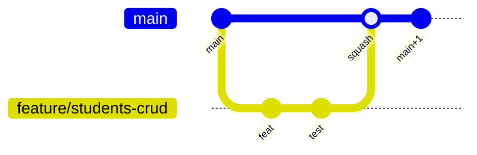

# Git Workflow Guide — Faculty Management System

## 1. Document Purpose

This document standardizes **team Git usage** for the Spinozah AI Education project. All team members must comply to maintain a **neat, traceable, and collaboratively efficient** repository.

**Enforcement:** CI workflows (when present) validate PR base branch, lint, tests, and coverage. Branch naming warnings are non-blocking but should be followed.

---

## 2. Repository Model

### 2.1 Trunk-Based Development

- **`main`** is the **only long-lived branch**
- All production-ready code lives on `main`
- Short-lived feature branches merge back via Pull Request
- No permanent `develop`, `release/*`, or `hotfix/*` branches



---

## 3. Branch Management

### 3.1 Creating a Branch

Always branch from latest `main`:

```bash
git fetch origin
git checkout main
git pull origin main
git checkout -b feature/students-enrolment-crud
```

### 3.2 Branch Naming Convention

| Prefix | Use case | Example |
|--------|----------|---------|
| `feature/` | New functionality | `feature/scheduling-conflict-detection` |
| `fix/` | Bug fixes | `fix/attendance-leave-count` |
| `improvement/` | Non-breaking enhancements | `improvement/frontend-dashboard-kpi` |
| `chore/` | Tooling, deps, config | `chore/upgrade-next-16` |
| `docs/` | Documentation only | `docs/system-architecture` |

**Format:** `<prefix>/<context>-<short-description>`

- Use **kebab-case** after the prefix
- Include bounded context or module when applicable: `feature/attendance-leave-approval`

### 3.3 Branch Lifetime

- Keep branches **short** (ideally &lt; 3 days)
- Rebase daily onto `main` to reduce merge pain
- Delete branch after PR is merged (GitHub option: auto-delete)

### 3.4 Syncing With Main

Run daily (or before opening PR):

```bash
git fetch origin
git rebase origin/main
```

If already pushed, push with lease (never force-push `main`):

```bash
git push --force-with-lease
```

**Forbidden:** `git push --force` to shared branches, especially `main`.

---

## 4. Commit Message Standards

### 4.1 Conventional Commits

Every commit MUST follow:

```text
<type>(<scope>): <subject>

[optional body]

[optional footer]
```

### 4.2 Types

| Type | When |
|------|------|
| `feat` | New feature |
| `fix` | Bug fix |
| `test` | Tests only |
| `docs` | Documentation |
| `refactor` | Code change without behavior change |
| `chore` | Build, tooling, deps |
| `perf` | Performance improvement |
| `ci` | CI configuration |

### 4.3 Scopes (Bounded Contexts)

Must match a project module:

`identity`, `students`, `scheduling`, `attendance`, `finance`, `ai-analysis`, `parent-portal`, `planning`, `shared`, `frontend`

### 4.4 Examples

```text
feat(students): add enrolment API with lesson balance

fix(attendance): correct free leave count after term reset

test(scheduling): add conflict detection unit tests

docs(shared): add system architecture document

chore(frontend): bump eslint-config-next
```

### 4.5 Subject Line Rules

- Imperative mood: "add" not "added"
- No period at end
- ≤ 72 characters
- **Explain WHY in body**, not WHAT (the diff shows what)

```text
feat(finance): generate semester invoice on enrolment renewal

Auto-invoicing reduces frontdesk manual work and prevents
missed billing when parents renew packages online.
```

---

## 5. Development Workflow (Required Order)

Every feature or bugfix follows this sequence:

| Step | Action |
|------|--------|
| 1 | Create branch from `main` |
| 2 | Read relevant `docs/` and identify bounded context |
| 3 | Write **failing tests** first |
| 4 | Implement (Domain → Application → Infrastructure → API) |
| 5 | Run lint and tests (`make lint`, `make test` or equivalents) |
| 6 | Commit with Conventional Commits |
| 7 | Push and open PR to `main` |
| 8 | Pass CI + review → **Squash and merge** |

---

## 6. Pull Request Process

### 6.1 Before Opening a PR

- [ ] Rebased on latest `origin/main`
- [ ] All tests pass locally
- [ ] Lint and type checks pass
- [ ] Coverage ≥ 80% overall, ≥ 90% domain (backend)
- [ ] No secrets or `.env` files committed
- [ ] PR size &lt; **800 lines** changed (split if larger)

### 6.2 Push Branch

```bash
git push -u origin feature/your-branch-name
```

### 6.3 Create PR

Target branch: **`main` only** (CI fails otherwise).

**Title:** Same format as Conventional Commit subject.

**Body template:**

```markdown
## Summary
- Bullet points of what changed

## Motivation
Why this change is needed

## Changes
- Module A: ...
- Module B: ...

## Testing checklist
- [ ] Unit tests added/updated
- [ ] Integration tests (if API/DB)
- [ ] Tenant isolation test (if repository)
- [ ] Manual smoke test steps
```

**CLI example:**

```bash
gh pr create --base main --title "feat(students): add enrolment API" --body "$(cat <<'EOF'
## Summary
- Add POST /api/v1/students/enrolments

## Motivation
Frontdesk needs programmatic enrolment with lesson counts.

## Changes
- students domain: Enrolment aggregate
- application: CreateEnrolmentHandler
- api: router + schemas

## Testing checklist
- [x] test_create_enrolment_success
- [x] test_tenant_a_cannot_see_tenant_b_data
- [ ] Manual: create enrolment in staging
EOF
)"
```

### 6.4 Review & Merge Requirements

1. **CI pipeline** — all checks green (target: 6 checks)
   - PR base branch = `main`
   - Backend lint + tests + coverage
   - Frontend lint + tests + build
2. **AI review bot** (if enabled)
3. **Human code owner approval**
4. Merge method: **Squash and merge** only
5. Delete source branch after merge

### 6.5 After Merge

```bash
git checkout main
git pull origin main
# delete local feature branch
git branch -d feature/your-branch-name
```

---

## 7. Code Conflict Resolution

### 7.1 Prevent Conflicts

- Rebase onto `main` daily
- Keep PRs small and focused
- Coordinate schema migrations in one PR when possible

### 7.2 Rebase Workflow

```bash
git fetch origin
git rebase origin/main
```

If conflicts occur:

```bash
# Git pauses at each conflicted commit
# Edit files to resolve <<<<<<< markers
git add <resolved-files>
git rebase --continue
```

Abort if needed:

```bash
git rebase --abort
```

After successful rebase and prior push:

```bash
git push --force-with-lease
```

### 7.3 Conflict Resolution Rules

| Area | Guideline |
|------|-----------|
| `package-lock.json` | Regenerate: checkout one side then `npm install` |
| Alembic migrations | Merge heads carefully; one linear history preferred |
| Same file, same feature | Coordinate with author; combine logic intentionally |
| Generated files | Prefer regeneration over manual merge |

### 7.4 Never Do

- Merge `main` into long-lived branches repeatedly without rebase (messy history)
- Force-push `main`
- Resolve conflicts by deleting others' business logic without review
- Commit conflict markers (`<<<<<<<`)

---

## 8. Protected Branch Rules (Recommended GitHub Settings)

| Rule | Setting |
|------|---------|
| Branch | `main` |
| Require PR | Yes |
| Require approvals | ≥ 1 |
| Require status checks | All CI jobs |
| Require linear history | Optional (squash merge helps) |
| Allow force push | **No** |
| Restrict who can push | Admins only direct push (emergency) |

---

## 9. Hotfix Process

For production-critical fixes:

```bash
git checkout main
git pull origin main
git checkout -b fix/finance-invoice-rounding-error
# fix + test + commit
git push -u origin fix/finance-invoice-rounding-error
# Open PR, expedited review, squash merge
```

Deploy from `main` immediately after merge per `04-operations-manual.md`.

---

## 10. AI-Assisted Development (Optional)

When using Linear + Cursor skills:

1. Pick issue from Linear (priority order)
2. Branch name from issue: `feature/{module}-{short-description}`
3. Update Linear status: In Progress → In Review → Done
4. Link PR URL in Linear issue

See `.cursor/skills/linear-driven-dev/SKILL.md` and `pr-ci-merge/SKILL.md`.

---

## 11. Linear Issue Conventions

**Title format:**

```text
[p{priority}][{Type}][{module}] {title}
```

Example: `[p1][Feature][students] Add enrolment API with lesson balance`

**Modules:** same as commit scopes (§4.3).

---

## 12. Quick Reference Card

```bash
# Start work
git checkout main && git pull
git checkout -b feature/students-enrolment-crud

# Develop (tests first)
make test && make lint

# Commit
git add -A
git commit -m "feat(students): add enrolment use case"

# Sync before PR
git fetch origin && git rebase origin/main
git push -u origin feature/students-enrolment-crud

# After merge
git checkout main && git pull
git branch -d feature/students-enrolment-crud
```

---

## 13. Related Documents

| Document | Topic |
|----------|-------|
| `.cursor/rules/workflow.mdc` | Enforced dev workflow |
| `03-technical-standards.md` | Lint, test, coverage |
| `04-operations-manual.md` | Deploy after merge |
| `01-system_architecture.md` | Module boundaries for scopes |

---

## 14. Revision History

| Version | Date | Changes |
|---------|------|---------|
| 1.0 | 2026-05-19 | Initial Git workflow guide (education scopes) |
