```mermaid
flowchart LR
    W3[W3 FastAPI]
    W4[W4 DB]
    W5[W5 Docker]
    W6[W6 Tenant]
    W7[W7 API Client]
    W8[W8 JWT]
    W9[W9 RBAC]
    W10[W10 Users]
    W11[W11 Student Domain]
    W12[W12 Student API]
    W13[W13 Teacher API]
    W14[W14 Student UI]
    W15[W15 Scheduling]
    W16[W16 Conflicts]
    W17[W17 Timetable UI]
    W18[W18 Attendance]
    W19[W19 Leave]
    W20[W20 Finance]
    W21[W21 Parent Auth]
    W22[W22 Parent APIs]
    W23[W23 Admin KPI]
    W24[W24 Essay AI]
    W25[W25 Cambridge]
    W26[W26 University]

    W3 --> W4 --> W5 --> W6 --> W7
    W6 --> W8 --> W9 --> W10 --> W11 --> W12 --> W13 --> W14
    W13 --> W15 --> W16 --> W17 --> W18 --> W19 --> W20
    W9 --> W21 --> W22
    W15 --> W23
    W24 --> W25 --> W26
```

# Linear Project Plan — Spinozah AI Education

**Linear project:** [Spinozah AI Education](https://linear.app/aipoweredcvprime/project/spinozah-ai-education-a4a8ea19a3ca)  
**Team:** AI-PoweredCVPrime (`AIJOB`)  
**Plan created:** 2026-05-19  
**Last updated:** 2026-07-21 (v1.4)  
**Target delivery:** 2027-01-04  
**Cadence:** One feature per week, re-anchored after project hold

This plan is derived from `docs/function_development_skills_guide.md`, `docs/01-system_architecture.md`, and project workflow standards (DDD layers, test-first, bounded contexts).

---

## 0. Project Status (Actual Progress — 2026-07-21)

### Completed

| Area | Status | Evidence |
|------|--------|----------|
| Architecture docs | **Complete** | `docs/01`–`05`, this plan |
| Linear backlog | **Complete** | AIJOB-19–54 created |
| Next.js dashboard + module stubs | **Complete** | `app/page.tsx` |
| Environment | **Complete** | `.env.example`, `.env.local` |
| Exam Analysis MVP | **Done** | [AIJOB-49](https://linear.app/aipoweredcvprime/issue/AIJOB-49) — merged to `main` |
| GitHub Actions CI baseline | **Done** | [AIJOB-33](https://linear.app/aipoweredcvprime/issue/AIJOB-33) — `.github/workflows/` |
| Linear Done issues | **2 of 36** | AIJOB-49, AIJOB-33 |

### Hold note

Work paused for several weeks after Week 2 (CI). Timeline below **restarts from 2026-07-21** with the same weekly cadence. Stale May–Jul due dates are replaced.

### Not started (next)

| Area | Status | Next Linear |
|------|--------|-------------|
| `backend/` FastAPI | Not started | **AIJOB-32** (W3 — current) |
| PostgreSQL / Alembic | Not started | AIJOB-29 |
| Docker Compose | Not started | AIJOB-30 |
| All M1–M3 features | Not started | W8+ |

### Linear workflow snapshot (synced 2026-07-21)

| Linear status | Count | Notes |
|---------------|-------|-------|
| **Done** | 2 | AIJOB-49, AIJOB-33 |
| **In Progress** | 0 | Set AIJOB-32 In Progress when coding resumes |
| **Todo** | 34 | Remaining epics + tasks (due dates refreshed below) |
| **Backlog** | 0 | — |

**Active repo:** https://github.com/brandyxie100/Spinozah_Educational_Administration_System  
**Next branch:** `feature/shared-fastapi-ddd-scaffold` (AIJOB-32)

---

## 1. Executive Summary

| Item | Value |
|------|-------|
| **Phases** | 3 product phases → 5 milestones → **26 weekly features** (2 done, **24 remaining**) |
| **Epics** | 10 (AIJOB-19 … AIJOB-28) |
| **Granular issues** | 26 tasks (AIJOB-29 … AIJOB-54) |
| **Total estimate** | ~155 story points (~remaining after Done) |
| **Cadence** | **One shippable feature per week** (Mon–Sun) |
| **Week 3 (current)** | AIJOB-32 — FastAPI DDD scaffold |
| **Platform critical path** | AIJOB-32 → AIJOB-29 → AIJOB-31 → AIJOB-35 → … → AIJOB-53 |

---

## 2. Milestones & Timeline

Re-anchored from **2026-07-21** after hold. Each remaining week delivers one primary feature.

| Milestone | Target date | Weeks | Goal | Progress |
|-----------|-------------|-------|------|----------|
| **Pre-work** | 2026-05-18 | Pre | Docs, UI shell, env, Linear | **Done** |
| **M-A — Exam Analysis MVP** | 2026-07-01 | W1 | Testable exam/question analysis (Next.js) | **Done** |
| **M0 — Foundation & DevEx** | 2026-08-24 | W2–W7 | CI (**done**), FastAPI, DB, Docker, tenant, API client | **~14%** (CI only) |
| **M1 — Core SaaS Operations** | 2026-11-16 | W8–W19 | Auth, students, scheduling, attendance | Not started |
| **M2 — AI Education & Parent Portal** | 2026-12-21 | W20–W24 | Finance, parent portal, admin, essay AI | Not started |
| **M3 — AI Planning Platform** | **2027-01-04** | W25–W26 | Cambridge planner, university pathway | Not started |

---

## 3. Weekly Feature Calendar (from 2026-07-21)

One primary feature per week. Due date = **Sunday** of each week.

| Week | Dates | Feature | Linear | Milestone | Status |
|------|-------|---------|--------|-----------|--------|
| **W1** | (completed) | Exam Analysis MVP | AIJOB-49 | M-A | **Done** |
| **W2** | (completed) | CI baseline — GitHub Actions | AIJOB-33 | M0 | **Done** |
| **W3** | Jul 21 – Jul 27 | **FastAPI DDD scaffold** | AIJOB-32 | M0 | **Current** |
| **W4** | Jul 28 – Aug 3 | PostgreSQL schema + Alembic | AIJOB-29 | M0 | Planned |
| **W5** | Aug 4 – Aug 10 | Docker Compose local stack | AIJOB-30 | M0 | Planned |
| **W6** | Aug 11 – Aug 17 | Multi-tenant repository + isolation tests | AIJOB-31 | M0 | Planned |
| **W7** | Aug 18 – Aug 24 | Frontend API client + TanStack Query | AIJOB-34 | M0 | Planned |
| **W8** | Aug 25 – Aug 31 | JWT auth + refresh flow | AIJOB-35 | M1 | Planned |
| **W9** | Sep 1 – Sep 7 | RBAC middleware | AIJOB-36 | M1 | Planned |
| **W10** | Sep 8 – Sep 14 | User management CRUD | AIJOB-38 | M1 | Planned |
| **W11** | Sep 15 – Sep 21 | Student schema + domain model | AIJOB-37 | M1 | Planned |
| **W12** | Sep 22 – Sep 28 | Student CRUD API | AIJOB-39 | M1 | Planned |
| **W13** | Sep 29 – Oct 5 | Teacher CRUD API | AIJOB-40 | M1 | Planned |
| **W14** | Oct 6 – Oct 12 | Student Management UI | AIJOB-41 | M1 | Planned |
| **W15** | Oct 13 – Oct 19 | Schedule schema + recurrence engine | AIJOB-42 | M1 | Planned |
| **W16** | Oct 20 – Oct 26 | Conflict detection service | AIJOB-43 | M1 | Planned |
| **W17** | Oct 27 – Nov 2 | Teacher Timetable UI | AIJOB-44 | M1 | Planned |
| **W18** | Nov 3 – Nov 9 | Attendance check-in | AIJOB-45 | M1 | Planned |
| **W19** | Nov 10 – Nov 16 | Leave policy engine | AIJOB-47 | M1 | Planned |
| **W20** | Nov 17 – Nov 23 | Invoice generation + PDF | AIJOB-46 | M2 | Planned |
| **W21** | Nov 24 – Nov 30 | Magic-link parent auth | AIJOB-51 | M2 | Planned |
| **W22** | Dec 1 – Dec 7 | Parent dashboard APIs | AIJOB-48 | M2 | Planned |
| **W23** | Dec 8 – Dec 14 | Admin KPI dashboard | AIJOB-50 | M2 | Planned |
| **W24** | Dec 15 – Dec 21 | AI essay analysis | AIJOB-52 | M2 | Planned |
| **W25** | Dec 22 – Dec 28 | Cambridge learning planner | AIJOB-54 | M3 | Planned |
| **W26** | Dec 29 – Jan 4 | University pathway engine | AIJOB-53 | M3 | Planned |

---

## 4. Bounded Contexts (Issue Scopes)

| Module | Responsibility |
|--------|----------------|
| `shared` | Scaffold, DB, Docker, CI, multi-tenant base |
| `identity` | Auth, users, RBAC |
| `students` | Students, teachers, enrolment |
| `scheduling` | Timetables, conflicts |
| `attendance` | Check-in, leave policy |
| `finance` | Invoices, payments |
| `parent-portal` | Parent auth & views |
| `ai-analysis` | Exam, essay, OCR/LLM |
| `planning` | Cambridge planner, university pathway |
| `frontend` | Next.js UI modules |

**Issue title format:** `[p{n}][{Type}][{module}] {title}`

---

## 5. Epic Breakdown (Parent Issues)

| ID | Epic | Milestone | Week window | Linear |
|----|------|-----------|-------------|--------|
| AIJOB-26 | AI Exam & Essay Analysis | M-A / M2 | W1 done; W24 | Todo |
| AIJOB-19 | M0 Foundation & DevEx | M0 | W2 done; W3 – W7 | Todo |
| AIJOB-20 | Authentication & RBAC | M1 | W8 – W10 | Todo |
| AIJOB-21 | Students & Teachers CRUD | M1 | W11 – W14 | Todo |
| AIJOB-22 | Teacher Scheduling Engine | M1 | W15 – W17 | Todo |
| AIJOB-23 | Attendance & Leave System | M1 | W18 – W19 | Todo |
| AIJOB-24 | Finance & Invoicing | M2 | W20 | Todo |
| AIJOB-25 | Parent Portal | M2 | W21 – W22 | Todo |
| AIJOB-28 | Admin Dashboard & KPIs | M2 | W23 | Todo |
| AIJOB-27 | Learning & University Planning | M3 | W25 – W26 | Todo |

---

## 6. Granular Task Catalog

### Linear status legend

| Symbol | Meaning |
|--------|---------|
| `[ ]` | Backlog |
| `[T]` | Todo |
| `[~]` | In Progress |
| `[x]` | Done |

### Completed weeks

| Week | ID | Task | Linear |
|------|----|------|--------|
| W1 | AIJOB-49 | Exam Analysis MVP (Next.js) | `[x]` Done |
| W2 | AIJOB-33 | GitHub Actions CI baseline | `[x]` Done |

### Remaining weeks (one feature per week)

| Week | ID | Task | Est. | Due | Linear | Blocked by |
|------|----|------|------|-----|--------|------------|
| **W3** | AIJOB-32 | FastAPI DDD project scaffold | 3 | **Jul 27** | `[T]` | AIJOB-33 |
| W4 | AIJOB-29 | PostgreSQL schema + Alembic baseline | 5 | Aug 3 | `[T]` | AIJOB-32 |
| W5 | AIJOB-30 | Docker Compose local dev stack | 2 | Aug 10 | `[T]` | AIJOB-32 |
| W6 | AIJOB-31 | Multi-tenant repository + isolation tests | 3 | Aug 17 | `[T]` | AIJOB-29 |
| W7 | AIJOB-34 | API client + TanStack Query setup | 2 | Aug 24 | `[T]` | AIJOB-32 |
| W8 | AIJOB-35 | JWT auth + refresh flow | 5 | Aug 31 | `[T]` | AIJOB-31 |
| W9 | AIJOB-36 | RBAC middleware | 3 | Sep 7 | `[T]` | AIJOB-35 |
| W10 | AIJOB-38 | User management CRUD | 3 | Sep 14 | `[T]` | AIJOB-36 |
| W11 | AIJOB-37 | Student schema + domain | 3 | Sep 21 | `[T]` | AIJOB-29, AIJOB-35 |
| W12 | AIJOB-39 | Student CRUD API | 5 | Sep 28 | `[T]` | AIJOB-37 |
| W13 | AIJOB-40 | Teacher CRUD API | 3 | Oct 5 | `[T]` | AIJOB-37 |
| W14 | AIJOB-41 | Student Management UI | 5 | Oct 12 | `[T]` | AIJOB-39, AIJOB-34 |
| W15 | AIJOB-42 | Schedule schema + recurrence | 5 | Oct 19 | `[T]` | AIJOB-39, AIJOB-40 |
| W16 | AIJOB-43 | Conflict detection service | 5 | Oct 26 | `[T]` | AIJOB-42 |
| W17 | AIJOB-44 | Teacher Timetable UI | 5 | Nov 2 | `[T]` | AIJOB-42, AIJOB-34 |
| W18 | AIJOB-45 | Attendance check-in | 5 | Nov 9 | `[T]` | AIJOB-42, AIJOB-39 |
| W19 | AIJOB-47 | Leave policy engine | 8 | Nov 16 | `[T]` | AIJOB-45 |
| W20 | AIJOB-46 | Invoice generation + PDF | 8 | Nov 23 | `[T]` | AIJOB-39, AIJOB-23 |
| W21 | AIJOB-51 | Magic-link parent auth | 5 | Nov 30 | `[T]` | AIJOB-36 |
| W22 | AIJOB-48 | Parent dashboard APIs | 5 | Dec 7 | `[T]` | AIJOB-51, AIJOB-45, AIJOB-46 |
| W23 | AIJOB-50 | Admin KPI dashboard | 8 | Dec 14 | `[T]` | AIJOB-46, AIJOB-42 |
| W24 | AIJOB-52 | AI essay analysis | 8 | Dec 21 | `[T]` | AIJOB-49 |
| W25 | AIJOB-54 | Cambridge learning planner | 13 | Dec 28 | `[T]` | AIJOB-52, AIJOB-49 |
| W26 | AIJOB-53 | University pathway engine | 13 | **Jan 4, 2027** | `[T]` | AIJOB-54 |

---

## 7. Dependency Graph

### 7.1 Weekly execution track (remaining)



### 7.2 Active critical path (Week 3 — now)

```
Start AIJOB-32 FastAPI DDD scaffold → health endpoint → PR → Done
  → W4 AIJOB-29 (PostgreSQL + Alembic)
```

### 7.3 Platform critical path

```
AIJOB-32 → AIJOB-29 → AIJOB-31 → AIJOB-35 → AIJOB-37 → AIJOB-39
  → AIJOB-42 → AIJOB-45 → AIJOB-46 → AIJOB-52 → AIJOB-54 → AIJOB-53
```

---

## 8. Priority Matrix

| Priority | Meaning | Active examples |
|----------|---------|-----------------|
| **p1 / Urgent** | Current week | AIJOB-32 — FastAPI scaffold by Jul 27 |
| **p2 / High** | Next 4 weeks | AIJOB-29, 30, 31, 34 |
| **p3 / Medium** | UI polish weeks | AIJOB-34, 41, 44 |

---

## 9. Development Standards (Per Issue)

1. **Branch** from `main`: `feature/{module}-{description}`
2. **Tests first** — failing tests before implementation
3. **DDD layers** for platform; layered `lib/` for Next.js MVP
4. **Tenant test** for any new repository
5. **PR** < 800 lines, Conventional Commits, CI green
6. **One feature per week** — ship and mark Linear Done before starting the next

See `docs/05-git-workflow-guide.md`.

---

## 10. Skill Guide Mapping

| Cursor skill | Linear tasks | Week |
|--------------|--------------|------|
| Skill G/H — AI analysis | AIJOB-49, 52 | W1 done, W24 |
| Skill A — DB schema | AIJOB-29, 37, 42 | W4, W11, W15 |
| Skill B — FastAPI CRUD | AIJOB-39, 40, 38 | W10, W12, W13 |
| Skill C — Auth & RBAC | AIJOB-35, 36, 38 | W8, W9, W10 |
| Skill D — Scheduling | AIJOB-42, 43, 44 | W15, W16, W17 |
| Skill E — Attendance | AIJOB-45, 47 | W18, W19 |
| Skill F — Finance | AIJOB-46 | W20 |
| Skill K — Parent portal | AIJOB-51, 48 | W21, W22 |
| Skill L — Admin dashboard | AIJOB-50 | W23 |
| Phase 3 planning | AIJOB-54, 53 | W25, W26 |

---

## 11. Recommended Start Order (from 2026-07-21)

| Week | Action | Due | Linear |
|------|--------|-----|--------|
| **W3** | FastAPI DDD scaffold + `/health` | Jul 27 | AIJOB-32 |
| **W4** | PostgreSQL schema + Alembic baseline | Aug 3 | AIJOB-29 |
| **W5** | Docker Compose (API + DB + frontend) | Aug 10 | AIJOB-30 |
| **W6** | Multi-tenant repository + isolation tests | Aug 17 | AIJOB-31 |
| **W7** | Frontend API client + TanStack Query | Aug 24 | AIJOB-34 |

Then continue W8–W26 per §3 calendar.

**Weekly ritual:** Monday — set one issue In Progress; Sunday — PR merged + Linear Done.

**Restart checklist:**
1. `git checkout main && git pull`
2. Set AIJOB-32 → In Progress
3. Branch `feature/shared-fastapi-ddd-scaffold`
4. Ship by Jul 27

---

## 12. Risks & Mitigations

| Risk | Impact | Mitigation |
|------|--------|------------|
| Multi-week hold broke cadence | Stale due dates | v1.4 re-anchor from Jul 21; refresh Linear |
| One feature/week aggressive for 8–13 pt tasks | Schedule slip | Split large issues within the week; defer polish |
| No backend yet | M0 blocked | W3 FastAPI scaffold is first priority |
| Linear Todo queue ≠ sprint order | Wrong work started | Follow §11 order only |
| Holiday weeks (late Dec / New Year) | W25–W26 slip | Buffer into early Jan; protect M3 target Jan 4 |

---

## 13. Linear Links Quick Reference

- **Project:** https://linear.app/aipoweredcvprime/project/spinozah-ai-education-a4a8ea19a3ca
- **Done:** [AIJOB-49](https://linear.app/aipoweredcvprime/issue/AIJOB-49), [AIJOB-33](https://linear.app/aipoweredcvprime/issue/AIJOB-33)
- **Next up:** https://linear.app/aipoweredcvprime/issue/AIJOB-32 (W3 — FastAPI DDD scaffold)
- **Parent epic (M0):** https://linear.app/aipoweredcvprime/issue/AIJOB-19

---

## 14. Revision History

| Version | Date | Changes |
|---------|------|---------|
| 1.0 | 2026-05-19 | Initial plan synced to Linear AIJOB-19–54 |
| 1.1 | 2026-06-02 | Rebased: Track A exam MVP first; M0–M3 shifted |
| 1.2 | 2026-06-24 | Synced Linear snapshot; 2-week sprints |
| 1.3 | 2026-05-19 | Weekly cadence W1–W26; target Nov 15 |
| 1.3.1 | 2026-05-19 | Synced Linear issue/epic/milestone dates to weekly plan |
| 1.4 | 2026-07-21 | **Restart after hold:** 2 Done (AIJOB-49, 33); re-anchor W3–W26 from Jul 21; project target **Jan 4, 2027**; Linear due dates + milestones refreshed |
