# Linear Project Plan — Spinozah AI Education

**Linear project:** [Spinozah AI Education](https://linear.app/aipoweredcvprime/project/spinozah-ai-education-a4a8ea19a3ca)  
**Team:** AI-PoweredCVPrime (`AIJOB`)  
**Plan created:** 2026-05-19  
**Last updated:** 2026-07-22 (v1.5)  
**Target delivery:** 2027-01-04  
**Cadence:** One feature per week (W1–W26 complete); UI polish backlog next

This plan is derived from `docs/function_development_skills_guide.md`, `docs/01-system_architecture.md`, and project workflow standards (DDD layers, test-first, bounded contexts).

---

## 0. Project Status (Actual Progress — 2026-07-22)

### Completed (W1–W26)

| Area | Status | Evidence |
|------|--------|----------|
| Architecture docs | **Complete** | `docs/01`–`05`, this plan |
| Linear backlog (AIJOB-19–54) | **Done** | All granular issues + epics closed |
| FastAPI DDD + multi-tenant DB | **Done** | `backend/`, Alembic migrations |
| Auth / students / scheduling / attendance APIs | **Done** | M1 write APIs |
| Finance, parent portal, admin KPI APIs + UI | **Done** | M2 (admin UI live; finance/parent APIs live) |
| Exam/essay AI, Cambridge planner, pathway | **Done** | M3 Next.js AI modules |
| GitHub Actions CI | **Done** | `.github/workflows/` |

### Remaining product gaps (UI polish)

| Dashboard module | Backend | Frontend |
|------------------|---------|----------|
| Attendance & Leave | Write APIs shipped | **Placeholder** — list APIs + UI next |
| Finance & Invoice | Invoice APIs shipped | **Placeholder** |
| Parent Portal | Magic link + reads shipped | **Placeholder** |

### Linear workflow snapshot (synced 2026-07-22)

| Linear status | Count | Notes |
|---------------|-------|-------|
| **Done** | AIJOB-19–54 (epics + tasks) | Planned critical path complete |
| **Todo / Backlog** | Polish epic + children | Dashboard UI wiring (see §11) |
| **In Progress** | 0–1 | Attendance UI when coding |

**Active repo:** https://github.com/brandyxie100/Spinozah_Educational_Administration_System

---

## 1. Executive Summary

| Item | Value |
|------|-------|
| **Phases** | 3 product phases → 5 milestones → **26 weekly features** — **all Done** |
| **Epics** | 10 (AIJOB-19 … AIJOB-28) — **Done** |
| **Granular issues** | 26 tasks (AIJOB-29 … AIJOB-54) — **Done** |
| **Cadence** | One shippable feature per week (historical W1–W26) |
| **Next focus** | Dashboard UI polish: Attendance → Finance → Parent Portal |
| **Platform critical path** | Completed through AIJOB-53 |

---

## 2. Milestones & Timeline

| Milestone | Target date | Weeks | Goal | Progress |
|-----------|-------------|-------|------|----------|
| **Pre-work** | 2026-05-18 | Pre | Docs, UI shell, env, Linear | **Done** |
| **M-A — Exam Analysis MVP** | 2026-07-01 | W1 | Testable exam/question analysis (Next.js) | **Done** |
| **M0 — Foundation & DevEx** | 2026-08-24 | W2–W7 | CI, FastAPI, DB, Docker, tenant, API client | **Done** |
| **M1 — Core SaaS Operations** | 2026-11-16 | W8–W19 | Auth, students, scheduling, attendance APIs | **Done** (Attendance UI polish remaining) |
| **M2 — AI Education & Parent Portal** | 2026-12-21 | W20–W24 | Finance, parent APIs, admin, essay AI | **Done** (Finance/Parent UI polish remaining) |
| **M3 — AI Planning Platform** | **2027-01-04** | W25–W26 | Cambridge planner, university pathway | **Done** |

---

## 3. Weekly Feature Calendar (from 2026-07-21)

One primary feature per week. Due date = **Sunday** of each week.

| Week | Dates | Feature | Linear | Milestone | Status |
|------|-------|---------|--------|-----------|--------|
| **W1** | (completed) | Exam Analysis MVP | AIJOB-49 | M-A | **Done** |
| **W2** | (completed) | CI baseline — GitHub Actions | AIJOB-33 | M0 | **Done** |
| **W3** | Jul 21 – Jul 27 | FastAPI DDD scaffold | AIJOB-32 | M0 | **Done** |
| **W4** | Jul 28 – Aug 3 | PostgreSQL schema + Alembic | AIJOB-29 | M0 | **Done** |
| **W5** | Aug 4 – Aug 10 | Docker Compose local stack | AIJOB-30 | M0 | **Done** |
| **W6** | Aug 11 – Aug 17 | Multi-tenant repository + isolation tests | AIJOB-31 | M0 | **Done** |
| **W7** | Aug 18 – Aug 24 | Frontend API client + TanStack Query | AIJOB-34 | M0 | **Done** |
| **W8** | Aug 25 – Aug 31 | JWT auth + refresh flow | AIJOB-35 | M1 | **Done** |
| **W9** | Sep 1 – Sep 7 | RBAC middleware | AIJOB-36 | M1 | **Done** |
| **W10** | Sep 8 – Sep 14 | User management CRUD | AIJOB-38 | M1 | **Done** |
| **W11** | Sep 15 – Sep 21 | Student schema + domain model | AIJOB-37 | M1 | **Done** |
| **W12** | Sep 22 – Sep 28 | Student CRUD API | AIJOB-39 | M1 | **Done** |
| **W13** | Sep 29 – Oct 5 | Teacher CRUD API | AIJOB-40 | M1 | **Done** |
| **W14** | Oct 6 – Oct 12 | Student Management UI | AIJOB-41 | M1 | **Done** |
| **W15** | Oct 13 – Oct 19 | Schedule schema + recurrence engine | AIJOB-42 | M1 | **Done** |
| **W16** | Oct 20 – Oct 26 | Conflict detection service | AIJOB-43 | M1 | **Done** |
| **W17** | Oct 27 – Nov 2 | Teacher Timetable UI | AIJOB-44 | M1 | **Done** |
| **W18** | Nov 3 – Nov 9 | Attendance check-in | AIJOB-45 | M1 | **Done** |
| **W19** | Nov 10 – Nov 16 | Leave policy engine | AIJOB-47 | M1 | **Done** |
| **W20** | Nov 17 – Nov 23 | Invoice generation + PDF | AIJOB-46 | M2 | **Done** |
| **W21** | Nov 24 – Nov 30 | Magic-link parent auth | AIJOB-51 | M2 | **Done** |
| **W22** | Dec 1 – Dec 7 | Parent dashboard APIs | AIJOB-48 | M2 | **Done** |
| **W23** | Dec 8 – Dec 14 | Admin KPI dashboard | AIJOB-50 | M2 | **Done** |
| **W24** | Dec 15 – Dec 21 | AI essay analysis | AIJOB-52 | M2 | **Done** |
| **W25** | Dec 22 – Dec 28 | Cambridge learning planner | AIJOB-54 | M3 | **Done** |
| **W26** | Dec 29 – Jan 4 | University pathway engine | AIJOB-53 | M3 | **Done** |

---

## 4. Bounded Contexts (Issue Scopes)

| Module | Responsibility |
|--------|----------------|
| `shared` | Scaffold, DB, Docker, CI, multi-tenant base |
| `identity` | Auth, users, RBAC |
| `students` | Students, teachers, enrolment |
| `scheduling` | Timetables, conflicts |
| `attendance` | Check-in, leave policy |
| `finance` | Invoices, payments |
| `parent-portal` | Parent auth & views |
| `ai-analysis` | Exam, essay, OCR/LLM |
| `planning` | Cambridge planner, university pathway |
| `frontend` | Next.js UI modules |

**Issue title format:** `[p{n}][{Type}][{module}] {title}`

---

## 5. Epic Breakdown (Parent Issues)

| ID | Epic | Milestone | Week window | Linear |
|----|------|-----------|-------------|--------|
| AIJOB-26 | AI Exam & Essay Analysis | M-A / M2 | W1; W24 | **Done** |
| AIJOB-19 | M0 Foundation & DevEx | M0 | W2 – W7 | **Done** |
| AIJOB-20 | Authentication & RBAC | M1 | W8 – W10 | **Done** |
| AIJOB-21 | Students & Teachers CRUD | M1 | W11 – W14 | **Done** |
| AIJOB-22 | Teacher Scheduling Engine | M1 | W15 – W17 | **Done** |
| AIJOB-23 | Attendance & Leave System | M1 | W18 – W19 | **Done** |
| AIJOB-24 | Finance & Invoicing | M2 | W20 | **Done** |
| AIJOB-25 | Parent Portal | M2 | W21 – W22 | **Done** |
| AIJOB-28 | Admin Dashboard & KPIs | M2 | W23 | **Done** |
| AIJOB-27 | Learning & University Planning | M3 | W25 – W26 | **Done** |

---

## 6. Granular Task Catalog

### Linear status legend

| Symbol | Meaning |
|--------|---------|
| `[ ]` | Backlog |
| `[T]` | Todo |
| `[~]` | In Progress |
| `[x]` | Done |

### Completed weeks (W1–W26)

| Week | ID | Task | Linear |
|------|----|------|--------|
| W1 | AIJOB-49 | Exam Analysis MVP (Next.js) | `[x]` Done |
| W2 | AIJOB-33 | GitHub Actions CI baseline | `[x]` Done |
| W3 | AIJOB-32 | FastAPI DDD project scaffold | `[x]` Done |
| W4 | AIJOB-29 | PostgreSQL schema + Alembic baseline | `[x]` Done |
| W5 | AIJOB-30 | Docker Compose local dev stack | `[x]` Done |
| W6 | AIJOB-31 | Multi-tenant repository + isolation tests | `[x]` Done |
| W7 | AIJOB-34 | API client + TanStack Query setup | `[x]` Done |
| W8 | AIJOB-35 | JWT auth + refresh flow | `[x]` Done |
| W9 | AIJOB-36 | RBAC middleware | `[x]` Done |
| W10 | AIJOB-38 | User management CRUD | `[x]` Done |
| W11 | AIJOB-37 | Student schema + domain | `[x]` Done |
| W12 | AIJOB-39 | Student CRUD API | `[x]` Done |
| W13 | AIJOB-40 | Teacher CRUD API | `[x]` Done |
| W14 | AIJOB-41 | Student Management UI | `[x]` Done |
| W15 | AIJOB-42 | Schedule schema + recurrence | `[x]` Done |
| W16 | AIJOB-43 | Conflict detection service | `[x]` Done |
| W17 | AIJOB-44 | Teacher Timetable UI | `[x]` Done |
| W18 | AIJOB-45 | Attendance check-in | `[x]` Done |
| W19 | AIJOB-47 | Leave policy engine | `[x]` Done |
| W20 | AIJOB-46 | Invoice generation + PDF | `[x]` Done |
| W21 | AIJOB-51 | Magic-link parent auth | `[x]` Done |
| W22 | AIJOB-48 | Parent dashboard APIs | `[x]` Done |
| W23 | AIJOB-50 | Admin KPI dashboard | `[x]` Done |
| W24 | AIJOB-52 | AI essay analysis | `[x]` Done |
| W25 | AIJOB-54 | Cambridge learning planner | `[x]` Done |
| W26 | AIJOB-53 | University pathway engine | `[x]` Done |

---

## 7. Dependency Graph

### 7.1 Weekly execution track (completed)

```mermaid
flowchart LR
    W3[W3 FastAPI]
    W4[W4 DB]
    W5[W5 Docker]
    W6[W6 Tenant]
    W7[W7 API Client]
    W8[W8 JWT]
    W9[W9 RBAC]
    W10[W10 Users]
    W11[W11 Student Domain]
    W12[W12 Student API]
    W13[W13 Teacher API]
    W14[W14 Student UI]
    W15[W15 Scheduling]
    W16[W16 Conflicts]
    W17[W17 Timetable UI]
    W18[W18 Attendance]
    W19[W19 Leave]
    W20[W20 Finance]
    W21[W21 Parent Auth]
    W22[W22 Parent APIs]
    W23[W23 Admin KPI]
    W24[W24 Essay AI]
    W25[W25 Cambridge]
    W26[W26 University]

    W3 --> W4 --> W5 --> W6 --> W7
    W6 --> W8 --> W9 --> W10 --> W11 --> W12 --> W13 --> W14
    W13 --> W15 --> W16 --> W17 --> W18 --> W19 --> W20
    W9 --> W21 --> W22
    W15 --> W23
    W24 --> W25 --> W26
```



### 7.2 Platform critical path (completed)

```
AIJOB-32 → AIJOB-29 → AIJOB-31 → AIJOB-35 → AIJOB-37 → AIJOB-39
  → AIJOB-42 → AIJOB-45 → AIJOB-46 → AIJOB-52 → AIJOB-54 → AIJOB-53
```

---

## 8. Priority Matrix

| Priority | Meaning | Active examples |
|----------|---------|-----------------|
| **p1 / Urgent** | Current polish week | Attendance list APIs + dashboard UI |
| **p2 / High** | Next polish weeks | Finance invoice UI; Parent portal UI |
| **p3 / Medium** | Deferred extras | Pathway PDF, NCEA/IB, FastAPI AI persistence |

---

## 9. Development Standards (Per Issue)

1. **Branch** from `main`: `feature/{module}-{description}`
2. **Tests first** — failing tests before implementation
3. **DDD layers** for platform; layered `lib/` for Next.js MVP
4. **Tenant test** for any new repository
5. **PR** < 800 lines, Conventional Commits, CI green
6. **One feature per week** — ship and mark Linear Done before starting the next

See `docs/05-git-workflow-guide.md`.

---

## 10. Skill Guide Mapping

| Cursor skill | Linear tasks | Week |
|--------------|--------------|------|
| Skill G/H — AI analysis | AIJOB-49, 52 | W1, W24 |
| Skill A — DB schema | AIJOB-29, 37, 42 | W4, W11, W15 |
| Skill B — FastAPI CRUD | AIJOB-39, 40, 38 | W10, W12, W13 |
| Skill C — Auth & RBAC | AIJOB-35, 36, 38 | W8, W9, W10 |
| Skill D — Scheduling | AIJOB-42, 43, 44 | W15, W16, W17 |
| Skill E — Attendance | AIJOB-45, 47 | W18, W19 |
| Skill F — Finance | AIJOB-46 | W20 |
| Skill K — Parent portal | AIJOB-51, 48 | W21, W22 |
| Skill L — Admin dashboard | AIJOB-50 | W23 |
| Phase 3 planning | AIJOB-54, 53 | W25, W26 |

---

## 11. Recommended Start Order (from 2026-07-22)

W1–W26 planned features are **Done**. Next cadence is dashboard UI polish:

| Order | Action | Module |
|-------|--------|--------|
| **1** | Attendance & leave list APIs + dashboard UI | `attendance` / `frontend` |
| **2** | Finance invoice management UI | `finance` / `frontend` |
| **3** | Parent portal login and student dashboard UI | `parent-portal` / `frontend` |

**Weekly ritual:** Monday — set one issue In Progress; Sunday — PR merged + Linear Done.

---

## 12. Risks & Mitigations

| Risk | Impact | Mitigation |
|------|--------|------------|
| APIs Done but dashboard placeholders remain | Looks unfinished to users | Polish backlog: Attendance → Finance → Parent |
| Attendance write-only APIs | UI cannot list pending rows | Add GET list endpoints before UI |
| Doc statuses lagging Linear | False “14 pending todos” | v1.5 sync (this revision) |
| Holiday weeks (late Dec / New Year) | Historical W25–W26 | Protected M3 target; shipped |

---

## 13. Linear Links Quick Reference

- **Project:** https://linear.app/aipoweredcvprime/project/spinozah-ai-education-a4a8ea19a3ca
- **Critical path:** AIJOB-29 … AIJOB-54 — **Done**
- **Next up:** Dashboard UI polish (Attendance first)

---

## 14. Revision History

| Version | Date | Changes |
|---------|------|---------|
| 1.0 | 2026-05-19 | Initial plan synced to Linear AIJOB-19–54 |
| 1.1 | 2026-06-02 | Rebased: Track A exam MVP first; M0–M3 shifted |
| 1.2 | 2026-06-24 | Synced Linear snapshot; 2-week sprints |
| 1.3 | 2026-05-19 | Weekly cadence W1–W26; target Nov 15 |
| 1.3.1 | 2026-05-19 | Synced Linear issue/epic/milestone dates to weekly plan |
| 1.4 | 2026-07-21 | **Restart after hold:** 2 Done (AIJOB-49, 33); re-anchor W3–W26 from Jul 21; project target **Jan 4, 2027**; Linear due dates + milestones refreshed |
| 1.5 | 2026-07-22 | **W1–W26 complete:** milestones/epics/weeks → Done; next = UI polish (Attendance → Finance → Parent) |
