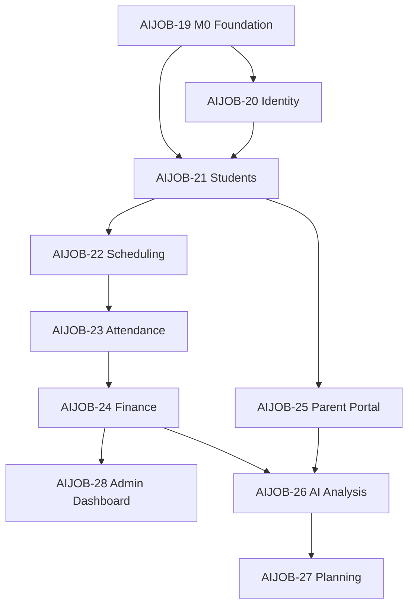

# Linear Project Plan — Spinozah AI Education

**Linear project:** [Spinozah AI Education](https://linear.app/aipoweredcvprime/project/spinozah-ai-education-a4a8ea19a3ca)  
**Team:** AI-PoweredCVPrime (`AIJOB`)  
**Plan created:** 2026-05-19  
**Target delivery:** 2026-08-18 (13 weeks)

This plan is derived from `docs/function_development_skills_guide.md`, `docs/01-system_architecture.md`, and project workflow standards (DDD layers, test-first, bounded contexts).

---

## 1. Executive Summary

| Item | Value |
|------|-------|
| **Phases** | 3 product phases → 4 milestones → 6 sprints |
| **Epics** | 10 (AIJOB-19 … AIJOB-28) |
| **Granular issues** | 26 tasks (AIJOB-29 … AIJOB-54) |
| **Total estimate** | ~155 story points |
| **Critical path** | AIJOB-32 → AIJOB-31 → AIJOB-35 → AIJOB-39 → AIJOB-42 → AIJOB-45 → AIJOB-46 → AIJOB-49 → AIJOB-54 |

---

## 2. Milestones & Timeline

| Milestone | Target date | Sprint(s) | Goal |
|-----------|-------------|-----------|------|
| **M0 — Foundation & DevEx** | 2026-06-02 | Sprint 0 | FastAPI DDD, DB, Docker, CI, tenant isolation |
| **M1 — Core SaaS Operations** | 2026-06-30 | Sprint 1–2 | Auth, students, scheduling, attendance |
| **M2 — AI Education & Parent Portal** | 2026-07-28 | Sprint 3–4 | Finance, parent portal, admin dashboard, AI analysis |
| **M3 — AI Planning Platform** | 2026-08-18 | Sprint 5 | Cambridge planner, university pathway |

### Sprint calendar

| Sprint | Dates | Focus |
|--------|-------|-------|
| **0** | May 19 – Jun 2 | Foundation (shared, frontend plumbing) |
| **1** | Jun 3 – Jun 16 | Identity + students/teachers |
| **2** | Jun 17 – Jun 30 | Scheduling + attendance |
| **3** | Jul 1 – Jul 14 | Finance + parent portal + admin UI |
| **4** | Jul 15 – Jul 28 | AI exam/essay analysis |
| **5** | Jul 29 – Aug 18 | Learning & university planning |

---

## 3. Bounded Contexts (Issue Scopes)

Aligned with architecture docs (not legacy resume/optimization scopes):

| Module | Responsibility |
|--------|----------------|
| `shared` | Scaffold, DB, Docker, CI, multi-tenant base |
| `identity` | Auth, users, RBAC |
| `students` | Students, teachers, enrolment |
| `scheduling` | Timetables, conflicts |
| `attendance` | Check-in, leave policy |
| `finance` | Invoices, payments |
| `parent-portal` | Parent auth & views |
| `ai-analysis` | Exam, essay, OCR/LLM |
| `planning` | Cambridge planner, university pathway |
| `frontend` | Next.js UI modules |

**Issue title format:** `[p{n}][{Type}][{module}] {title}`

---

## 4. Epic Breakdown (Parent Issues)

| ID | Epic | Milestone | Sprint window |
|----|------|-----------|---------------|
| AIJOB-19 | M0 Foundation & DevEx | M0 | May 19 – Jun 2 |
| AIJOB-20 | Sprint 1 — Authentication & RBAC | M1 | Jun 3 – Jun 9 |
| AIJOB-21 | Sprint 1 — Students & Teachers CRUD | M1 | Jun 10 – Jun 16 |
| AIJOB-22 | Sprint 2 — Teacher Scheduling Engine | M1 | Jun 17 – Jun 23 |
| AIJOB-23 | Sprint 2 — Attendance & Leave System | M1 | Jun 24 – Jun 30 |
| AIJOB-24 | Sprint 3 — Finance & Invoicing | M2 | Jul 1 – Jul 7 |
| AIJOB-25 | Sprint 3 — Parent Portal | M2 | Jul 8 – Jul 14 |
| AIJOB-28 | Sprint 3 — Admin Dashboard & KPIs | M2 | Jul 8 – Jul 14 |
| AIJOB-26 | Sprint 4 — AI Exam & Essay Analysis | M2 | Jul 15 – Jul 28 |
| AIJOB-27 | Sprint 5 — Learning & University Planning | M3 | Jul 29 – Aug 18 |

---

## 5. Granular Task Catalog

### M0 — Foundation (parent: AIJOB-19)

| ID | Task | Est. | Due | Blocked by |
|----|------|------|-----|------------|
| AIJOB-32 | FastAPI DDD project scaffold | 3 | May 23 | — |
| AIJOB-29 | PostgreSQL schema + Alembic baseline | 5 | May 28 | AIJOB-32 |
| AIJOB-30 | Docker Compose local dev stack | 2 | May 30 | AIJOB-32 |
| AIJOB-31 | Multi-tenant repository + isolation tests | 3 | Jun 2 | AIJOB-29 |
| AIJOB-33 | GitHub Actions CI baseline | 3 | Jun 2 | AIJOB-32 |
| AIJOB-34 | API client + TanStack Query setup | 2 | Jun 2 | AIJOB-32 |

### Sprint 1 — Identity (parent: AIJOB-20)

| ID | Task | Est. | Due | Blocked by |
|----|------|------|-----|------------|
| AIJOB-35 | JWT auth + refresh flow | 5 | Jun 5 | AIJOB-31 |
| AIJOB-36 | RBAC middleware | 3 | Jun 7 | AIJOB-35 |
| AIJOB-38 | User management CRUD | 3 | Jun 9 | AIJOB-36 |

**Epic AIJOB-20** blocked by **AIJOB-31**.

### Sprint 1 — Students (parent: AIJOB-21)

| ID | Task | Est. | Due | Blocked by |
|----|------|------|-----|------------|
| AIJOB-37 | Student schema + domain | 3 | Jun 11 | AIJOB-29, AIJOB-35 |
| AIJOB-39 | Student CRUD API | 5 | Jun 13 | AIJOB-37 |
| AIJOB-40 | Teacher CRUD API | 3 | Jun 14 | AIJOB-37 |
| AIJOB-41 | Student Management UI | 5 | Jun 16 | AIJOB-39, AIJOB-34 |

**Epic AIJOB-21** blocked by **AIJOB-35**.

### Sprint 2 — Scheduling (parent: AIJOB-22)

| ID | Task | Est. | Due | Blocked by |
|----|------|------|-----|------------|
| AIJOB-42 | Schedule schema + recurrence | 5 | Jun 19 | AIJOB-39, AIJOB-40 |
| AIJOB-43 | Conflict detection service | 5 | Jun 21 | AIJOB-42 |
| AIJOB-44 | Teacher Timetable UI | 5 | Jun 23 | AIJOB-42, AIJOB-34 |

**Epic AIJOB-22** blocked by **AIJOB-21**.

### Sprint 2 — Attendance (parent: AIJOB-23)

| ID | Task | Est. | Due | Blocked by |
|----|------|------|-----|------------|
| AIJOB-45 | Attendance check-in | 5 | Jun 26 | AIJOB-42, AIJOB-39 |
| AIJOB-47 | Leave policy engine | 8 | Jun 28 | AIJOB-45 |

**Epic AIJOB-23** blocked by **AIJOB-22**.

### Sprint 3 — Finance (parent: AIJOB-24)

| ID | Task | Est. | Due | Blocked by |
|----|------|------|-----|------------|
| AIJOB-46 | Invoice generation + PDF | 8 | Jul 7 | AIJOB-39, AIJOB-23 |

**Epic AIJOB-24** blocked by **AIJOB-23**.

### Sprint 3 — Parent portal (parent: AIJOB-25)

| ID | Task | Est. | Due | Blocked by |
|----|------|------|-----|------------|
| AIJOB-51 | Magic-link parent auth | 5 | Jul 10 | AIJOB-36 |
| AIJOB-48 | Parent dashboard APIs | 5 | Jul 14 | AIJOB-51, AIJOB-45, AIJOB-46 |

**Epic AIJOB-25** blocked by **AIJOB-21**.

### Sprint 3 — Admin UI (parent: AIJOB-28)

| ID | Task | Est. | Due | Blocked by |
|----|------|------|-----|------------|
| AIJOB-50 | Admin KPI dashboard | 8 | Jul 14 | AIJOB-46, AIJOB-42 |

### Sprint 4 — AI analysis (parent: AIJOB-26)

| ID | Task | Est. | Due | Blocked by |
|----|------|------|-----|------------|
| AIJOB-49 | Exam PDF pipeline (FastAPI + S3) | 8 | Jul 20 | AIJOB-32, AIJOB-39 |
| AIJOB-52 | AI essay analysis | 8 | Jul 25 | AIJOB-49 |

**Epic AIJOB-26** blocked by **AIJOB-24**, **AIJOB-25**.

### Sprint 5 — Planning (parent: AIJOB-27)

| ID | Task | Est. | Due | Blocked by |
|----|------|------|-----|------------|
| AIJOB-54 | Cambridge learning planner | 13 | Aug 8 | AIJOB-52, AIJOB-49 |
| AIJOB-53 | University pathway engine | 13 | Aug 18 | AIJOB-54 |

**Epic AIJOB-27** blocked by **AIJOB-26**.

---

## 6. Dependency Graph (Validated)

### 6.1 Epic-level chain (no cycles)



**Validation:** Topological order exists. No epic blocks an ancestor.

### 6.2 Critical path (longest chain)

```
AIJOB-32 (scaffold)
  → AIJOB-29 (DB)
    → AIJOB-31 (tenant)
      → AIJOB-35 (JWT)
        → AIJOB-37 (student schema)
          → AIJOB-39 (student API)
            → AIJOB-42 (schedules)
              → AIJOB-45 (attendance)
                → AIJOB-46 (invoices)
                  → AIJOB-49 (exam AI)
                    → AIJOB-52 (essay AI)
                      → AIJOB-54 (Cambridge)
                        → AIJOB-53 (university)
```

**Duration risk:** Any slip on M0 or Sprint 1 pushes commercial modules (Sprint 5).

### 6.3 Parallel workstreams (after M0 gate)

| Stream | Can start after | Issues |
|--------|-----------------|--------|
| Identity | AIJOB-31 | AIJOB-35, 36, 38 |
| Students | AIJOB-35 | AIJOB-37–41 |
| CI / Docker | AIJOB-32 | AIJOB-30, 33 |
| Frontend plumbing | AIJOB-32 | AIJOB-34 |

| Stream | Can start after | Issues |
|--------|-----------------|--------|
| Parent portal | AIJOB-36 + AIJOB-21 | AIJOB-51, 48 |
| Admin dashboard | AIJOB-42 + AIJOB-46 | AIJOB-50 |
| Essay AI | AIJOB-49 | AIJOB-52 |

### 6.4 Dependency rules enforced in Linear

| Rule | Rationale |
|------|-----------|
| All M1+ blocked on tenant isolation (AIJOB-31) | Security requirement |
| Auth chain: 35 → 36 → 38 | RBAC requires tokens |
| Scheduling requires students + teachers | Foreign keys & conflict checks |
| Attendance requires schedules | Check-in tied to lessons |
| Finance requires attendance + students | Billing uses consumption data |
| AI analysis requires students + scaffold | Reports per student |
| Planning requires AI analysis outputs | Uses weakness/report data |

---

## 7. Priority Matrix

| Priority | Meaning | Examples |
|----------|---------|----------|
| **p1 / Urgent** | Blocking or core risk | AIJOB-32, 35, 43, 47, 49 |
| **p2 / High** | Sprint commitment | Most epics and APIs |
| **p3 / Medium** | UI polish, can slip 1 sprint | AIJOB-34, 41, 44 |

**Commercial priority (product guide):** After operational core, prioritize AIJOB-49, 52, 54, 53 (exam → essay → Cambridge → university).

---

## 8. Development Standards (Per Issue)

Every granular issue must follow:

1. **Branch** from `main`: `feature/{module}-{description}`
2. **Tests first** — failing tests before implementation
3. **DDD layers** — Domain → Application → Infrastructure → API
4. **Tenant test** for any new repository
5. **PR** &lt; 800 lines, Conventional Commits, CI green

See `docs/05-git-workflow-guide.md` and `.cursor/rules/workflow.mdc`.

---

## 9. Skill Guide Mapping

| Cursor skill | Linear epic / tasks |
|--------------|---------------------|
| Skill A — DB schema | AIJOB-29, 37, 42 |
| Skill B — FastAPI CRUD | AIJOB-39, 40, 38 |
| Skill C — Auth & RBAC | AIJOB-35, 36, 38 |
| Skill D — Scheduling | AIJOB-42, 43, 44 |
| Skill E — Attendance | AIJOB-45, 47 |
| Skill F — Finance | AIJOB-46 |
| Skill G/H — AI analysis | AIJOB-49, 52 |
| Skill K — Parent portal | AIJOB-51, 48 |
| Skill L — Admin dashboard | AIJOB-50 |
| Phase 3 planning | AIJOB-54, 53 |

---

## 10. Recommended Start Order (Next 5 issues)

1. **AIJOB-32** — FastAPI DDD scaffold (unblocks everything)
2. **AIJOB-29** — PostgreSQL + Alembic
3. **AIJOB-30** — Docker Compose (parallel with 29)
4. **AIJOB-31** — Tenant isolation (M0 exit gate)
5. **AIJOB-35** — JWT authentication (Sprint 1 kickoff)

---

## 11. Risks & Mitigations

| Risk | Impact | Mitigation |
|------|--------|------------|
| M0 slips past Jun 2 | All sprints shift | Timebox scaffold; defer CI polish to AIJOB-33 |
| Leave policy complexity (AIJOB-47) | Sprint 2 overrun | Spike domain rules early in AIJOB-45 |
| AI cost/latency (AIJOB-49+) | Sprint 4 slip | Adapter interface; cache reports |
| Single developer | Parallel streams underused | Focus critical path; defer AIJOB-44 UI if needed |

---

## 12. Linear Links Quick Reference

- **Project:** https://linear.app/aipoweredcvprime/project/spinozah-ai-education-a4a8ea19a3ca
- **First task:** https://linear.app/aipoweredcvprime/issue/AIJOB-32

---

## 13. Revision History

| Version | Date | Changes |
|---------|------|---------|
| 1.0 | 2026-05-19 | Initial plan synced to Linear AIJOB-19–54 |
